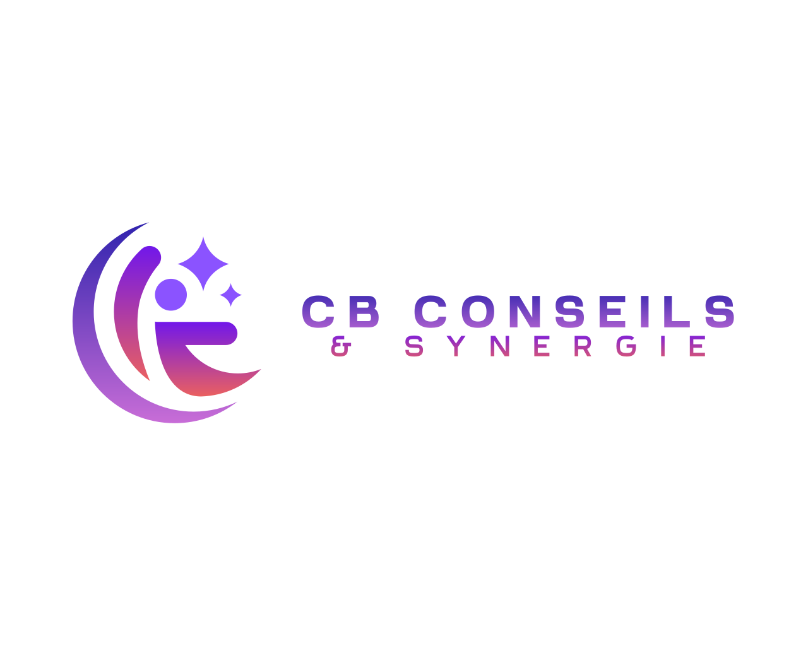
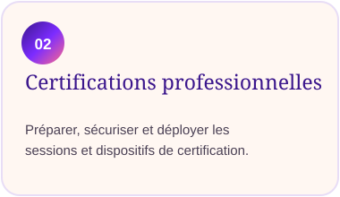
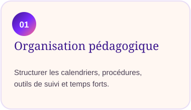
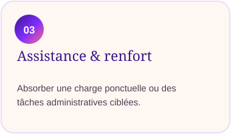

 

**STRUCTURER** &nbsp;•&nbsp; **SÉCURISER** &nbsp;•&nbsp; **FLUIDIFIER**

# Bonjour, moi c'est Céline 👋

### Coordination pédagogique · Certifications professionnelles · Développement web & outils métier

J'aime transformer les organisations complexes en processus lisibles, 
et les besoins métier en outils simples, utiles et maintenables.

 

 

## Un profil métier, une culture technique

Je suis **Céline Berthon**, coordinatrice pédagogique et consultante indépendante, fondatrice de **CB Conseils & Synergie**.

J'évolue dans la formation professionnelle et l'enseignement supérieur, avec une expertise particulière en **organisation pédagogique**, **certifications professionnelles**, **coordination opérationnelle** et **structuration des processus**.

Mais mon parcours ne s'arrête pas là.

Formée au développement web, j'ai conservé cette culture technique et je l'utilise aujourd'hui pour concevoir mes propres solutions numériques : sites web, applications, interfaces et outils internes pensés à partir de besoins métier réels.

> Pour moi, le développement n'est pas une fin en soi : c'est un moyen de résoudre proprement un problème concret.

 

## Mes domaines d'expertise

<table align="center">
<tr>
<td width="33%" valign="top">

</td>
<td width="33%" valign="top">

</td>
<td width="33%" valign="top">

</td>
</tr>
</table>

 

## Côté développement

Mon approche du développement part presque toujours d'un besoin concret : **simplifier, automatiser, centraliser ou rendre une information plus accessible**.

### Web

### Applications & données

### Environnement

 

## CB Conseils & Synergie

**CB Conseils & Synergie** est mon activité indépendante de conseil et d'accompagnement des organismes de formation, CFA et établissements d'enseignement.

<table align="center">
<tr>
<td width="25%" align="center">

### Depuis 2019

au cœur de la formation professionnelle

</td>
<td width="25%" align="center">

### 50+

sessions de certification organisées

</td>
<td width="25%" align="center">

### 1000+

candidats accompagnés vers la certification

</td>
<td width="25%" align="center">

### Plus de 20 ans

d'expérience professionnelle

</td>
</tr>
</table>

J'y réunis mes deux cultures professionnelles : **comprendre les réalités opérationnelles d'un établissement** et **concevoir les méthodes ou les outils qui permettent de les simplifier**.

 

 

## Ce que je développe actuellement

Mes projets personnels et professionnels explorent notamment :

- la création de **sites web accessibles et responsives** ;
- le développement d'**applications Android métier** ;
- la conception d'**outils de gestion et de suivi** ;
- l'automatisation de tâches administratives ;
- la création d'interfaces pensées pour un usage réel plutôt que pour une démonstration technique.

Une partie de ces projets est volontairement conservée dans des dépôts privés lorsqu'elle contient des outils internes ou des éléments liés à mon activité professionnelle.

 

## Échangeons

Une question, un projet ou simplement envie de parler organisation, formation ou développement ?

 

&nbsp;&nbsp;

  

CB Conseils & Synergie · Organisation pédagogique · Certification professionnelle · Développement & outils métier

